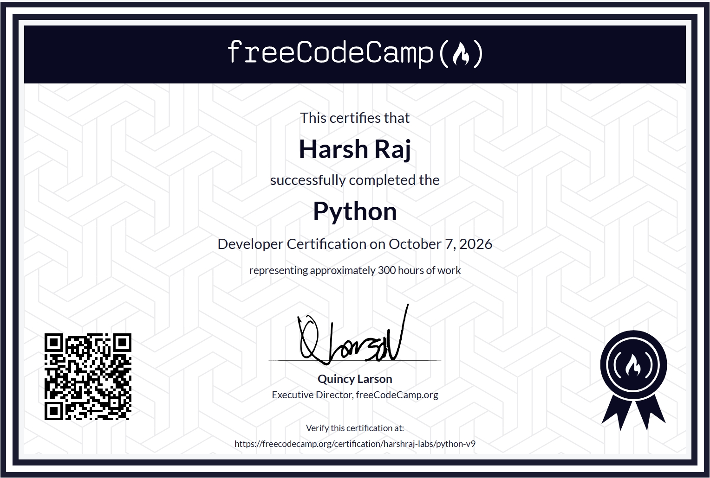

## Purpose:
- Created this repositary to keep me on the track for my python learning journey from freecodecamp, forcing me to do atleast 1 topic per day and commit it to github.

## Output:
- Completed the course
- Certificate of completion.

